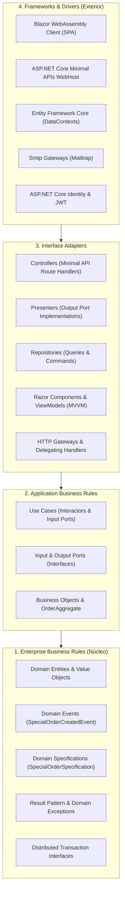
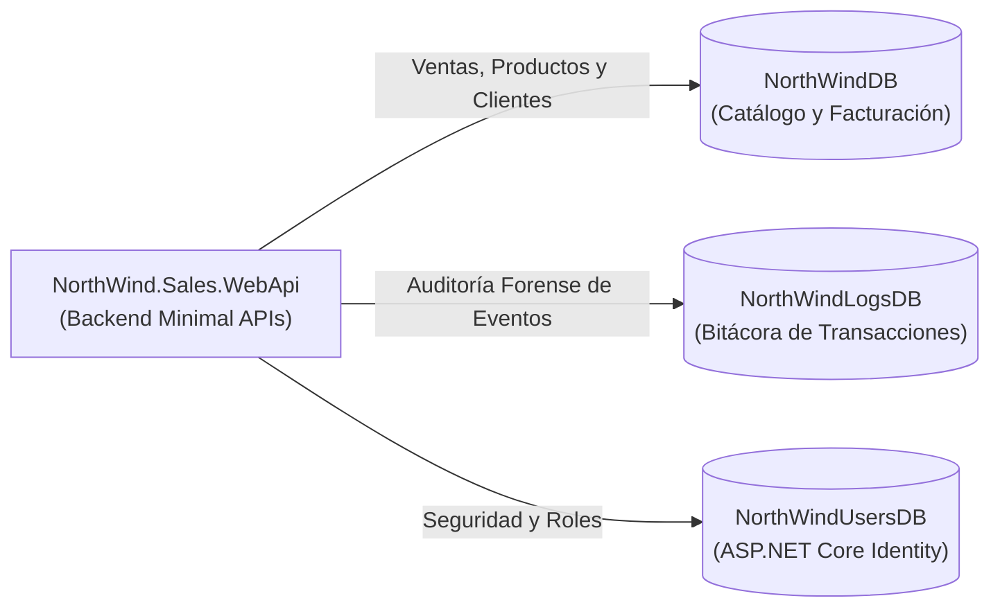
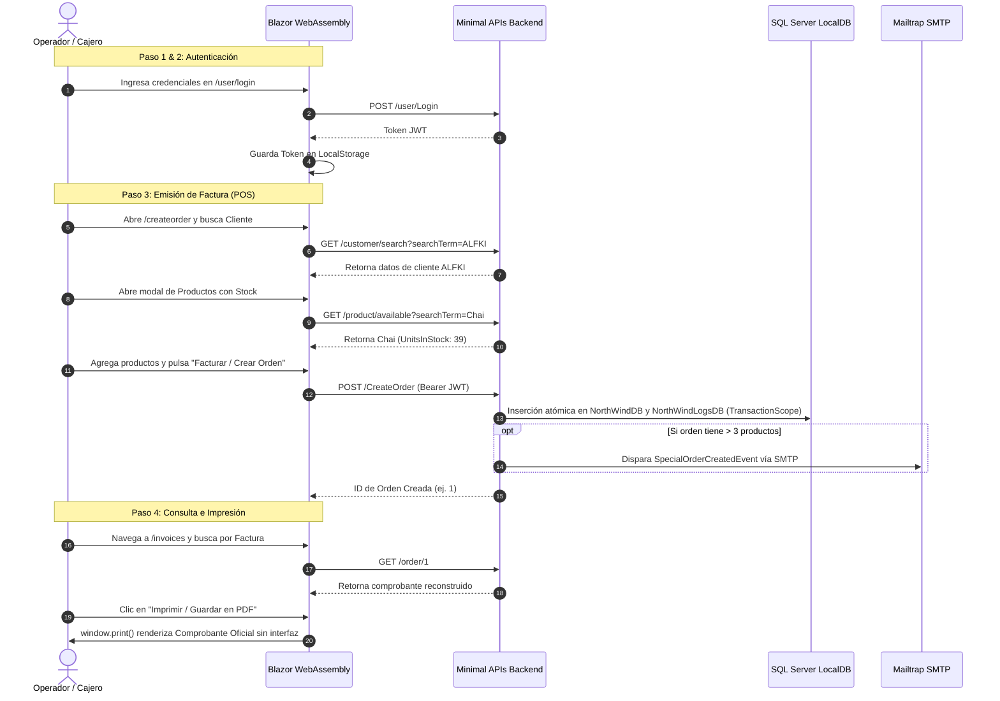

# NorthWind POS & Invoicing System - Clean Architecture en .NET 8

[](https://dotnet.microsoft.com/)
[](https://learn.microsoft.com/dotnet/csharp/)
[](https://learn.microsoft.com/aspnet/core/fundamentals/minimal-apis)
[](https://dotnet.microsoft.com/apps/aspnet/web-apps/blazor)
[](https://learn.microsoft.com/ef/core/)
[](https://learn.microsoft.com/sql/database-engine/configure-windows/sql-server-express-localdb)
[](#3-arquitectura-de-software-y-patrones)
[](#licencia)

Sistema modular de **Punto de Venta (POS) y Facturación Electrónica** de grado empresarial desarrollado en **.NET 8** bajo los principios rigurosos de **Clean Architecture** (Arquitectura Limpia de Robert C. Martin). El sistema integra un backend de alto rendimiento desacoplado con **ASP.NET Core Minimal APIs** y un frontend de página única (SPA) reactivo en **Blazor WebAssembly**, incorporando múltiples bases de datos relacionales en SQL Server LocalDB, control estricto de inventario, transacciones distribuidas ACID con `TransactionScope`, eventos de dominio, validaciones con FluentValidation y seguridad JWT con ASP.NET Core Identity.

---

## Tabla de Contenidos

1. [Descripción General](#1-descripción-general)
2. [Módulos y Funcionalidades Principales (Punto de Venta)](#2-módulos-y-funcionalidades-principales-punto-de-venta)
   - [Ventana 1: Carrito de Facturación Dinámico (`/createorder`)](#ventana-1-carrito-de-facturación-dinámico-createorder)
   - [Ventana 2: Modal de Búsqueda Inteligente de Clientes](#ventana-2-modal-de-búsqueda-inteligente-de-clientes)
   - [Ventana 3: Modal de Búsqueda Inteligente de Productos](#ventana-3-modal-de-búsqueda-inteligente-de-productos)
   - [Ventana 4: Módulo de Historial y Visualización de Facturas (`/invoices`)](#ventana-4-módulo-de-historial-y-visualización-de-facturas-invoices)
3. [Arquitectura de Software y Patrones](#3-arquitectura-de-software-y-patrones)
   - [Regla de Dependencia y las 4 Capas Concéntricas](#regla-de-dependencia-y-las-4-capas-concéntricas)
   - [Patrones de Diseño Implementados](#patrones-de-diseño-implementados)
4. [Bases de Datos (SQL Server LocalDB)](#4-bases-de-datos-sql-server-localdb)
5. [Catálogo de Endpoints RESTful](#5-catálogo-de-endpoints-restful)
6. [Requisitos Previos y Puesta en Marcha](#6-requisitos-previos-y-puesta-en-marcha)
   - [Prerrequisitos del Entorno](#prerrequisitos-del-entorno)
   - [Configuración de LocalDB y Migraciones de EF Core](#configuración-de-localdb-y-migraciones-de-ef-core)
   - [Configuración de `appsettings.json`](#configuración-de-appsettingsjson)
   - [Instrucciones de Ejecución Dual (Visual Studio y CLI)](#instrucciones-de-ejecución-dual-visual-studio-y-cli)
7. [Flujo de Prueba de Extremo a Extremo (E2E)](#7-flujo-de-prueba-de-extremo-a-extremo-e2e)
8. [Mapa Estructurado de Proyectos de la Solución](#8-mapa-estructurado-de-proyectos-de-la-solución)
9. [Licencia](#licencia)

---

## 1. Descripción General

**NorthWind POS & Invoicing System** es una solución integral diseñada para modernizar los procesos comerciales y de emisión de facturas electrónicas de la conocida compañía NorthWind Traders. 

### Puntos Destacados de la Solución:
- **Clean Architecture Estricta:** 4 capas concéntricas organizadas en 32 proyectos de biblioteca y aplicaciones host que desacoplan de forma absoluta la lógica de dominio de los detalles de infraestructura.
- **Backend Ligero con Minimal APIs:** Puntos de entrada HTTP compactos, de baja latencia y alta concurrencia.
- **Frontend SPA Reactivo con Blazor WebAssembly:** Interfaz gráfica interactiva, validaciones en tiempo de edición, modales desacoplados con debounce y capacidades nativas de renderizado e impresión de comprobantes comerciales.
- **Transacciones Distribuidas ACID:** Garantía de consistencia transaccional multi-base de datos mediante `TransactionScope`, actualizando simultáneamente el stock/órdenes en `NorthWindDB` y el registro de eventos en `NorthWindLogsDB`.
- **Ecosistema de Auditoría y Eventos:** Emisión asíncrona de notificaciones por correo (Mailtrap) ante órdenes especiales (> 3 productos) y registro detallado de auditoría forense con usuario y fecha/hora.

---

## 2. Módulos y Funcionalidades Principales (Punto de Venta)

El sistema de Punto de Venta (POS) y Facturación está articulado en cuatro módulos interactivos esenciales:

```
┌────────────────────────────────────────────────────────────────────────────────────────┐
│                        NorthWind POS & Invoicing System                                │
├────────────────────────────┬────────────────────────────┬──────────────────────────────┤
│ 🛒 Ventana 1: Carrito POS  │ 👥 Ventana 2: Búsqueda     │ 📦 Ventana 3: Búsqueda       │
│    Facturación Dinámica    │    Inteligente de Clientes │    de Productos con Stock    │
│    (Subtotal, IVA 15%, Tot)│    (Debounce + Paginación) │    (UnitsInStock > 0)        │
├────────────────────────────┴────────────────────────────┴──────────────────────────────┤
│ 📑 Ventana 4: Historial y Visualización de Facturas (/invoices)                        │
│    Reconstrucción del Comprobante Oficial + Impresión / Exportación PDF (@media print) │
└────────────────────────────────────────────────────────────────────────────────────────┘
```

### Ventana 1: Carrito de Facturación Dinámico (`/createorder`)
Componente: `CreateOrderComponent.razor` | ViewModel: `CreateOrderViewModel.cs`

- **Cálculo Financiero en Vivo:**
  - **Subtotal:** Sumatoria de totales de línea calculados en tiempo real:
    $$\text{Subtotal} = \sum (\text{Cantidad} \times \text{Precio Unitario})$$
  - **IVA (15%):** Tasa impositiva oficial calculada automáticamente sobre el subtotal neto:
    $$\text{IVA} = \text{Subtotal} \times 0.15$$
  - **Total de la Factura:** Liquidación final consolidada:
    $$\text{Total} = \text{Subtotal} + \text{IVA}$$
- **Control Estricto de Inventario en Tiempo Real:** Cada artículo añadido conoce sus `UnitsInStock`. La interfaz desactiva el botón de incremento (`+`) al alcanzar el stock máximo y bloquea el envío de la orden si cualquier cantidad excede las existencias reales.
- **Prevención de Productos Duplicados:** Al seleccionar un producto que ya se encuentra en el carrito, el sistema no duplica la fila: incrementa la cantidad existente de forma automática respetando el límite de stock.
- **Gestión Dinámica de Líneas de Detalle:**
  - Modificación reactiva de cantidades mediante botones `+` / `-` o entrada numérica directa.
  - Botón **"🔄 Cambiar"**: Permite sustituir un producto por otro del catálogo sin perder la fila, recalculando precios y ajustando la cantidad al stock del nuevo artículo.
  - Botón **"🗑️ Eliminar"**: Retira el producto del carrito y recalcula los totales de liquidación instantáneamente.
- **Autocompletado de Encabezado:** Formulario conectado que recibe los datos seleccionados del cliente y permite editar la dirección de entrega de ser requerido.

---

### Ventana 2: Modal de Búsqueda Inteligente de Clientes
Componente: `CustomerSearchModal.razor` | Gateway: `CustomerGateway.cs`

- **Búsqueda Multi-Criterio con Debounce:** Integra un temporizador de debounce (350 ms) que evita sobrecargar el servidor durante el tipeo y permite ejecutar la búsqueda instantáneamente al presionar <kbd>Enter</kbd> o el botón "Buscar".
- **Filtros Compuestos:** Permite localizar clientes mediante:
  - Código identificador único (`CustomerId`, ej. `ALFKI`, `ANATR`).
  - Nombre de la Empresa o Razón Social (`CompanyName`).
  - Nombre del Contacto comercial (`ContactName`).
- **Paginación por Bloques:** Navegación fluida por páginas con indicador de registros totales y control de botones Anterior / Siguiente.
- **Transferencia y Autocompletado Automático:** Con un solo clic en "Seleccionar", el modal transfiere al formulario de la orden:
  - Código de Cliente (`CustomerId`).
  - Razón Social (`CustomerName`).
  - Contacto (`ContactName`).
  - Dirección completa (`ShipAddress`, `ShipCity`, `ShipCountry`, `ShipPostalCode`).

---

### Ventana 3: Modal de Búsqueda Inteligente de Productos
Componente: `ProductSearchModal.razor` | Gateway: `ProductGateway.cs`

- **Filtro Automático de Stock Activo (`UnitsInStock > 0`):** La consulta backend garantiza que **únicamente se listan productos con inventario disponible mayor a cero**. Los artículos sin existencias quedan excluidos del modal, protegiendo al cajero de agregar productos agotados.
- **Búsqueda Reactiva con Debounce:** Filtro por ID numérico o nombre descriptivo del producto con debounce de 350 ms y soporte para tecla <kbd>Enter</kbd>.
- **Visualización Detallada:** Tabla con insignia de unidades en inventario (`UnitsInStock u.`) y precio unitario monetario formateado.
- **Modos Duales de Operación:**
  - **Modo Inserción:** Agrega un nuevo ítem al carrito de facturación o incrementa el stock si ya existía.
  - **Modo Sustitución:** Reemplaza un producto seleccionado en una fila existente por un nuevo ítem elegido en el catálogo.

---

### Ventana 4: Módulo de Historial y Visualización de Facturas (`/invoices`)
Página: `OrderHistory.razor` | Componente: `InvoiceDetailComponent.razor` | Gateway: `OrderInvoiceGateway.cs`

- **Búsqueda Dual de Comprobantes:**
  - **Por Número de Orden / Factura:** Búsqueda exacta ingresando el identificador numérico (ej. `1`, `2`, `10248`).
  - **Por Código o Nombre de Cliente:** Localiza todas las facturas asociadas a un cliente específico (ej. `ALFKI`), con selector directo a través del modal de clientes.
- **Reconstrucción Oficial del Comprobante Comercial:**
  - **Encabezado Corporativo Tributario:** Razón social de la empresa emisor (*NorthWind Sales Inc.*), RUC / NIT (`1792345678001`), dirección matriz, teléfono y correo electrónico.
  - **Caja de Emisión Oficial:** Número de comprobante correlativo formateado (`FACTURA Nº 00000X`), fecha y hora de emisión y sello/badge de estado `AUTORIZADA / PAGADA`.
  - **Datos Completos del Adquirente:** Razón social, código de cliente, contacto, dirección, ciudad, país y código postal.
  - **Tabla Detallada de Mercadería:** Numeración de ítems, código, descripción del producto, precio unitario, cantidad y total por línea.
  - **Cuadro de Liquidación Tributaria:** Desglose exacto de **Subtotal Neto**, **IVA (15%)** y **Total Factura**.
- **Impresión y Exportación Nativa a PDF:**
  - Estilos CSS dedicados mediante `@media print`:
    - Oculta automáticamente elementos superfluos de la interfaz (menú lateral, barra de navegación superior, botones y buscador).
    - Remueve sombras, optimiza contrastes a escala de grises y fija el ancho de página para hojas estándar A4 / Carta.
  - Invocación a `window.print()` vía `IJSRuntime` para enviar a impresora física o generar el PDF oficial directamente desde el diálogo nativo del navegador.

---

## 3. Arquitectura de Software y Patrones

El sistema adopta la **Arquitectura Limpia (Clean Architecture)** con separación concéntrica estricta en 4 capas. El núcleo del sistema permanece totalmente agnóstico de frameworks, tecnologías de persistencia y protocolos de transporte.

### Regla de Dependencia y las 4 Capas Concéntricas



| Capa | Responsabilidad Arquitectónica | Proyectos Clave |
| :--- | :--- | :--- |
| **1. Enterprise Business Rules** | Entidades puras, Value Objects, contratos de eventos, especificaciones y tipos base funcionales. Cero dependencias externas. | `NorthWind.Entities`, `NorthWind.Sales.Entities`, `NorthWind.Result.Entities`, `NorthWind.Events.Entities`, `NorthWind.Transactions.Entities` |
| **2. Application Business Rules** | Casos de uso (Interactors) que orquestan el flujo de negocio, reglas de aplicación y contratos de puertos (`InputPort`, `OutputPort`). | `NorthWind.Sales.Backend.UseCases`, `NorthWind.Sales.Backend.BusinessObjects`, `NorthWind.Membership.Backend.Core` |
| **3. Interface Adapters** | Conversores bidireccionales de datos: controladores HTTP para Minimal APIs, presentadores, repositorios, ViewModels y Gateways HTTP. | `NorthWind.Sales.Backend.Controllers`, `NorthWind.Sales.Backend.Presenters`, `NorthWind.Sales.Backend.Repositories`, `NorthWind.Sales.Frontend.Views`, `NorthWind.Sales.Frontend.WebApiGateways` |
| **4. Frameworks & Drivers** | Herramientas y tecnologías concretas: ASP.NET Core, EF Core, SQL Server, Blazor WebAssembly, Mailtrap, FluentValidation e Identity. | `NorthWind.Sales.WebApi`, `NorthWind.Sales.BlazorClient`, `NorthWind.Sales.Backend.DataContexts.EFCore`, `NorthWind.Membership.Backend.AspNetIdentity`, `NorthWind.Sales.Backend.SmtpGateways` |

---

### Patrones de Diseño Implementados

#### 1. Patrón `Result<T>` y `Result<TSuccess, TError>`
Reemplaza el uso costoso de excepciones para el control de flujo regular. Proporciona tipos monádicos que modelan explícitamente el éxito o fallo de una operación, con métodos utilitarios como `HandleResult(...)` para ramificar la ejecución limpiamente.

#### 2. Specification Pattern (`Specification<T>`)
Encapsula reglas de negocio complejas en objetos reutilizables basados en expresiones linq (`Expression<Func<T, bool>>`).
- **Ejemplo en el código:** `SpecialOrderSpecification`, que evalúa si una orden contiene más de 3 productos (`order.OrderDetails.Count > 3`).

#### 3. Domain Events (`IDomainEvent`, `IDomainEventHub`)
Desacopla los efectos secundarios de los casos de uso.
- Cuando una orden cumple la especificación especial, se dispara `SpecialOrderCreatedEvent`.
- El manejador `SpecialOrderCreatedEventHandler` captura el evento y envía una notificación asíncrona vía SMTP a Mailtrap sin que el caso de uso conozca detalles del envío de correos.

#### 4. `TransactionScope` (Transacciones Distribuidas ACID)
Garantiza atomicidad entre múltiples bases de datos relacionales sin acoplar el código a un motor específico:
- Habilita `TransactionManager.ImplicitDistributedTransactions = true` con nivel de aislamiento `ReadCommitted`.
- Si la inserción en `NorthWindDB` (ventas) o en `NorthWindLogsDB` (auditoría) falla, ambas operaciones se revierten automáticamente (Rollback).

#### 5. FluentValidation + RFC 7807 (ProblemDetails)
- Validación declarativa de DTOs antes de alcanzar el dominio mediante `IModelValidatorHub`.
- Las inconsistencias se transforman en respuestas estándar **RFC 7807 / RFC 7231 Problem Details** (HTTP 400), detallando cada campo inválido para su mapeo directo en el componente Blazor (`ModelValidator`).

#### 6. ASP.NET Core Identity & JWT con Delegating Handlers
- Autenticación robusta con hash seguro de contraseñas mediante ASP.NET Core Identity.
- Emisión de tokens firmados con **HMAC-SHA256**.
- En Blazor WebAssembly, el token se almacena en `localStorage` y se intercepta automáticamente en cada petición saliente mediante `MembershipBearerTokenHandler`, sincronizando el estado con `JWTAuthenticationStateProvider`.

---

## 4. Bases de Datos (SQL Server LocalDB)

El sistema utiliza **3 bases de datos desacopladas** sobre la instancia de SQL Server LocalDB, garantizando una alta cohesión y segregación de responsabilidades:



| Base de Datos | Contexto EF Core | Contenido y Esquema |
| :--- | :--- | :--- |
| **`NorthWindDB`** | `NorthWindContext` / `NorthWindSalesContext` | **Núcleo de Ventas y Catálogo:**<br>• `Customers`: Códigos de cliente (`ALFKI`, `ANATR`, `ANTON`), empresas, contactos y direcciones.<br>• `Products`: Artículos de catálogo con precios y existencias (`UnitsInStock`).<br>• `Orders`: Cabecera de órdenes de compra con datos de envío y fechas.<br>• `OrderDetails`: Líneas de factura con producto, cantidad y precio pactado. |
| **`NorthWindLogsDB`** | `NorthWindDomainLogsContext` | **Auditoría Forense del Sistema:**<br>• `Logs`: Registro inmutable con `Id`, `DateTime`, `User` (email del operador) y `Description` (ej. *Orden 1 creada para el cliente ALFKI*). Sincronizado atómicamente con `TransactionScope`. |
| **`NorthWindUsersDB`** | `NorthWindMembershipContext` | **Seguridad y Membresía:**<br>• Esquema estándar de ASP.NET Core Identity: `AspNetUsers`, `AspNetRoles`, `AspNetUserClaims`, `AspNetUserRoles`, `AspNetUserTokens`. |

---

## 5. Catálogo de Endpoints RESTful

El backend expone un conjunto optimizado de endpoints mediante Minimal APIs:

| Módulo | Método | Ruta del Endpoint | Autorización | Parámetros / Cuerpo | Respuesta Exitosa | Descripción |
| :--- | :---: | :--- | :---: | :--- | :---: | :--- |
| **Seguridad** | `POST` | `/user/Register` | Anónimo | Body: `UserRegistrationDto`<br>`{ firstName, lastName, email, password }` | `200 OK`<br>`(string userId)` | Registra un nuevo operador en `NorthWindUsersDB`. |
| **Seguridad** | `POST` | `/user/Login` | Anónimo | Body: `UserLoginDto`<br>`{ email, password }` | `200 OK`<br>`(string jwtToken)` | Valida credenciales y emite el token JWT de acceso. |
| **Ventas** | `POST` | `/CreateOrder` | `Bearer JWT` | Body: `CreateOrderDto`<br>`{ customerId, shipAddress, shipCity, shipCountry, shipPostalCode, orderDetails[] }` | `200 OK`<br>`(int orderId)` | Valida stock, ejecuta transacción distribuida, audita y genera la orden. |
| **Consultas POS** | `GET` | `/customer/search` | Anónimo | Query: `customerId`, `companyName`, `contactName`, `searchTerm`, `page`, `pageSize` | `200 OK`<br>`PagedResult<CustomerSearchDto>` | Búsqueda multi-criterio paginada de clientes. |
| **Consultas POS** | `GET` | `/product/available` | Anónimo | Query: `productId`, `productName`, `searchTerm`, `page`, `pageSize` | `200 OK`<br>`PagedResult<ProductSearchDto>` | Búsqueda de productos disponibles (**UnitsInStock > 0**). |
| **Facturas POS** | `GET` | `/order/{id:int}` | Anónimo | Route: `id` (Entero) | `200 OK`<br>`OrderInvoiceDto` | Retorna el detalle completo y liquidación de una factura por ID. |
| **Facturas POS** | `GET` | `/order/customer/{customerId}` | Anónimo | Route: `customerId` (String) | `200 OK`<br>`List<OrderInvoiceDto>` | Retorna todas las facturas históricas emitidas a un cliente. |

---

## 6. Requisitos Previos y Puesta en Marcha

### Prerrequisitos del Entorno
1. **.NET 8 SDK** (versión `8.0.100` o superior).
   ```powershell
   dotnet --version
   ```
2. **SQL Server LocalDB** (instancia `(localdb)\mssqllocaldb`).
3. **Herramienta global de EF Core CLI (`dotnet-ef`)**:
   ```powershell
   dotnet tool install --global dotnet-ef
   dotnet tool update --global dotnet-ef
   ```
4. **Visual Studio 2022** (v17.8+ con carga de trabajo *Desarrollo web y de ASP.NET*) o **Visual Studio Code** (con *C# Dev Kit*).
5. **Cuenta en Mailtrap (Opcional):** Para recibir y visualizar las alertas de órdenes especiales vía SMTP.

---

### Configuración de LocalDB y Migraciones de EF Core

#### Paso 1: Iniciar y verificar la instancia de LocalDB
```powershell
# 1. Verificar estado de LocalDB
sqllocaldb info

# 2. Iniciar la instancia por defecto
sqllocaldb start mssqllocaldb

# 3. Comprobar que esté en estado 'Running'
sqllocaldb info mssqllocaldb
```

> [!NOTE]
> Si la instancia `mssqllocaldb` no existe en el equipo, créala con `sqllocaldb create mssqllocaldb` antes de iniciarla.

#### Paso 2: Aplicar las migraciones a las 3 bases de datos
Ejecuta los siguientes comandos desde la **raíz de la solución**:

```powershell
# 1. Base de datos de Ventas y Catálogo (NorthWindDB)
dotnet ef database update --project NorthWind.Sales.Backend.DataContexts.EFCore --startup-project NorthWind.Sales.WebApi --context NorthWindContext

# 2. Base de datos de Auditoría Forense (NorthWindLogsDB)
dotnet ef database update --project NorthWind.DomainLogs.DataContexts.EFCore --startup-project NorthWind.Sales.WebApi --context NorthWindDomainLogsContext

# 3. Base de datos de Membresía e Identity (NorthWindUsersDB)
dotnet ef database update --project NorthWind.Membership.Backend.AspNetIdentity --startup-project NorthWind.Sales.WebApi --context NorthWindMembershipContext
```

---

### Configuración de `appsettings.json`

Verifica que el archivo `NorthWind.Sales.WebApi/appsettings.json` contenga las cadenas de conexión correctas:

```json
{
  "Logging": {
    "LogLevel": {
      "Default": "Information",
      "Microsoft.AspNetCore": "Warning"
    }
  },
  "AllowedHosts": "*",
  "ConnectionStrings": {
    "NorthWindDB": "Server=(localdb)\\mssqllocaldb;Database=NorthWindDB;Integrated Security=true;"
  },
  "DBOptions": {
    "ConnectionString": "Server=(localdb)\\mssqllocaldb;Database=NorthWindDB;Integrated Security=true;"
  },
  "DomainLogs": {
    "ConnectionString": "Server=(localdb)\\mssqllocaldb;Database=NorthWindLogsDB;Integrated Security=true;"
  },
  "MembershipDB": {
    "ConnectionString": "Server=(localdb)\\mssqllocaldb;Database=NorthWindUsersDB;Integrated Security=true;"
  },
  "Smtp": {
    "Host": "sandbox.smtp.mailtrap.io",
    "Port": 2525,
    "UserName": "TU_USUARIO_MAILTRAP",
    "Password": "TU_PASSWORD_MAILTRAP"
  },
  "JwtOptions": {
    "SecurityKey": "NorthWindSecretKeyForJwtTokenValidation2026!",
    "ValidIssuer": "NorthWindWebApi",
    "ValidAudience": "NorthWindClients",
    "ExpireInMinutes": 60,
    "ValidateIssuer": true,
    "ValidateAudience": true,
    "ValidateLifetime": true,
    "ValidateIssuerSigningKey": true
  }
}
```

> [!TIP]
> En `NorthWind.Sales.BlazorClient/wwwroot/appsettings.json`, confirma que `WebApiAddress` apunta a la URL del backend (`https://localhost:7154`).

---

### Instrucciones de Ejecución Dual (Visual Studio y CLI)

#### Opción A: Desde Visual Studio 2022 (Recomendado)
La solución incluye el archivo `NorthWind.slnLaunch.user` configurado para arranque concurrente:
1. Abre la solución `NorthWind.slnx` en Visual Studio.
2. En la barra superior de herramientas, verifica que el perfil de inicio múltiple esté activo (o haz clic derecho sobre la solución ➔ **Configurar proyectos de inicio...** ➔ **Varios proyectos de inicio**).
3. Asegúrate de que los proyectos tengan la acción **Iniciar**:
   - `NorthWind.Sales.WebApi` ➔ **Iniciar**
   - `NorthWind.Sales.BlazorClient` ➔ **Iniciar**
4. Presiona <kbd>F5</kbd> (Depuración) o <kbd>Ctrl</kbd> + <kbd>F5</kbd> (Sin depurar).

#### Opción B: Mediante Línea de Comandos (`dotnet run`)
Abre dos terminales de PowerShell en la raíz del proyecto:

**Terminal 1 — Backend (Minimal APIs):**
```powershell
dotnet run --project NorthWind.Sales.WebApi/NorthWind.Sales.WebApi.csproj
```
- Swagger UI interactivo: [https://localhost:7154/swagger](https://localhost:7154/swagger)
- Endpoint HTTP base: `http://localhost:5254`

**Terminal 2 — Frontend (Blazor WebAssembly):**
```powershell
dotnet run --project NorthWind.Sales.BlazorClient/NorthWind.Sales.BlazorClient.csproj
```
- Aplicación Web Blazor POS: [https://localhost:7227](https://localhost:7227)
- Endpoint HTTP alternativo: `http://localhost:5289`

---

## 7. Flujo de Prueba de Extremo a Extremo (E2E)

Sigue esta guía paso a paso para validar el ciclo comercial completo:



### Paso 1: Registro e Inicio de Sesión
1. Ingresa a `https://localhost:7227/user/register` y registra un usuario operador (ej. `cajero@northwind.com` / `Password123!`).
2. Ve a `https://localhost:7227/user/login` e inicia sesión. El sistema guardará el token JWT y habilitará las rutas comerciales protegidas en el menú lateral.

### Paso 2: Creación de la Orden con Carrito Dinámico y Control de Stock
1. Dirígete a la ruta **Crear Orden** (`/createorder`).
2. Haz clic en **"🔍 Buscar Cliente"**:
   - En el modal de búsqueda, escribe `ALFKI` o `Alfreds` (se activará el debounce automático).
   - Haz clic en **"Seleccionar"**. Observa cómo los datos de cliente, razón social y dirección se autocompletan instantáneamente en el encabezado.
3. Haz clic en **"➕ Buscar Producto"**:
   - En el modal de productos con stock, busca `Chai` (ID 1, Stock: 39). Haz clic en **"Seleccionar"**.
   - Haz clic de nuevo en **"➕ Buscar Producto"** y selecciona `Aniseed Syrup` (ID 3, Stock: 13).
4. **Verificación de Reglas de Negocio del Carrito:**
   - Observa cómo el Subtotal, el IVA (15%) y el Total de Factura se actualizan inmediatamente al variar cantidades con los botones `+` y `-`.
   - Si intentas presionar `+` repetidamente, el sistema bloqueará el incremento tan pronto alcances el límite del inventario disponible (`UnitsInStock`).
   - Prueba el botón **"🔄 Cambiar"** en una fila para sustituir un ítem por otro catálogo, o **"🗑️ Eliminar"** para descartar un producto y verificar el recálculo automático.
5. Haz clic en **"💳 Facturar / Crear Orden"**:
   - El sistema enviará la orden protegida con el JWT.
   - Recibirás una alerta verde con el mensaje de confirmación y el ID de la orden generada (ej. `Orden 1 creada exitosamente`).

### Paso 3: Disparo de Orden Especial (> 3 productos)
1. Agrega al carrito 4 productos distintos con stock (ej. `Chai`, `Aniseed Syrup`, `Chef Anton's Cajun Seasoning`, `Chef Anton's Gumbo Mix`).
2. Al pulsar **"Facturar / Crear Orden"**:
   - La especificación `SpecialOrderSpecification` detectará más de 3 líneas de detalle.
   - Se activará el evento de dominio `SpecialOrderCreatedEvent`.
   - Se enviará una notificación por correo electrónico a Mailtrap con el asunto y resumen de la orden especial.

### Paso 4: Consulta Histórica de Facturas y Exportación a PDF
1. En el menú de navegación, haz clic en **"Consultar Facturas"** (`/invoices`).
2. Ingresa el número de orden recién generado (ej. `1`) y presiona <kbd>Enter</kbd> o haz clic en **"Buscar"** (o presiona **"👥 Seleccionar Cliente..."** para ver todas las facturas de un cliente).
3. En la tabla de resultados, presiona el botón **"Ver Factura"**:
   - Se desplegará el comprobante comercial formal con el logotipo corporativo, RUC, número correlativo (`FACTURA Nº 000001`), detalle completo y cuadro de liquidación de impuestos.
4. Presiona el botón **"🖨️ Imprimir / Guardar en PDF"**:
   - Se invocará la orden nativa del navegador mediante `window.print()`.
   - Gracias a las directivas `@media print`, el menú lateral, los botones y la barra de navegación se ocultarán por completo, mostrando un documento limpio y formateado listo para guardarse como PDF o enviarse a impresión física.

---

## 8. Mapa Estructurado de Proyectos de la Solución

La solución `NorthWind.slnx` está conformada por **32 proyectos desacoplados**, organizados estrictamente en carpetas de solución según su capa arquitectónica:

### 1. Enterprise Business Rules (11 Proyectos)
| Proyecto | Rol Arquitectónico |
| :--- | :--- |
| `NorthWind.Entities` | Contratos base, tipos compartidos y entidades primitivas de dominio. |
| `NorthWind.Sales.Entities` | DTOs de venta (`CreateOrderDto`, `OrderDetailDto`), DTOs de búsqueda y facturación (`CustomerSearchDto`, `ProductSearchDto`, `OrderInvoiceDto`) y constantes de endpoints. |
| `NorthWind.DomainLogs.Entities` | Entidad de auditoría de dominio `DomainLog` (`Id`, `DateTime`, `User`, `Description`). |
| `NorthWind.Membership.Entities` | DTOs para membresía (`UserRegistrationDto`, `UserLoginDto`, `UserDto`) y rutas de seguridad. |
| `NorthWind.Events.Entities` | Contratos base del bus de eventos de dominio (`IDomainEvent`, `IDomainEventHub`). |
| `NorthWind.Exceptions.Entities` | Excepciones del dominio (`ValidationException`, `UpdateException`) y adaptadores RFC 7807 `ProblemDetails`. |
| `NorthWind.Result.Entities` | Implementación de tipos de resultado funcional (`Result<T>`, `Result<TSuccess, TError>`). |
| `NorthWind.Transactions.Entities` | Contrato de transacciones distribuidas `IDomainTransaction` con `TransactionScope`. |
| `NorthWind.Validation.Entities` | Contratos genéricos para validación de modelos (`IModelValidator`, `IModelValidatorHub`). |
| `NorthWind.Sales.Validators.Entities` | Reglas de validación para entidades de ventas. |
| `NorthWind.HttpDelegatingHandlers` | Delegating Handlers para interceptación y gestión centralizada de errores HTTP en clientes. |

### 2. Application Business Rules (4 Proyectos)
| Proyecto | Rol Arquitectónico |
| :--- | :--- |
| `NorthWind.Sales.Backend.UseCases` | Casos de uso de ventas (`CreateOrderInteractor`, `CustomerSearchInteractor`, `ProductSearchInteractor`, `OrderInvoiceInteractor`). |
| `NorthWind.Sales.Backend.BusinessObjects` | Agregados de negocio (`OrderAggregate`), eventos (`SpecialOrderCreatedEvent`) y especificaciones (`SpecialOrderSpecification`). |
| `NorthWind.Sales.Frontend.BusinessObjects` | Contratos de pasarelas de comunicación HTTP para el frontend (`ICreateOrderGateway`, `ICustomerGateway`, `IProductGateway`, `IOrderInvoiceGateway`). |
| `NorthWind.Membership.Backend.Core` | Casos de uso de autenticación (`UserLoginInteractor`, `UserRegistrationInteractor`) y generación de tokens JWT. |

### 3. Interface Adapters (7 Proyectos)
| Proyecto | Rol Arquitectónico |
| :--- | :--- |
| `NorthWind.Sales.Backend.Controllers` | Endpoints de ventas para Minimal APIs (`CreateOrderController`, `CustomerSearchController`, `ProductSearchController`, `OrderInvoiceController`). |
| `NorthWind.Sales.Backend.Presenters` | Presentadores que transforman las respuestas del caso de uso para los endpoints de Minimal API. |
| `NorthWind.Sales.Backend.Repositories` | Repositorios de persistencia (`CommandsRepository`, `QueriesRepository`) e interfaces de acceso a datos. |
| `NorthWind.Sales.Frontend.Views` | Vistas y componentes Blazor de ventas (`CreateOrderComponent`, `CustomerSearchModal`, `ProductSearchModal`, `InvoiceDetailComponent`, `OrderHistory`). |
| `NorthWind.Sales.Frontend.WebApiGateways` | Implementación de los Gateways clientes que consumen la Web API vía HTTP. |
| `NorthWind.Membership.Frontend.RazorViews` | Componentes de login y registro (`UserLoginPage`, `UserRegistrationPage`, `TokenLocalStorage`, `JWTAuthenticationStateProvider`). |
| `NorthWind.RazorComponents` | Componentes de UI transversales (`ExceptionDisplay`, `NavMenuLayout`, validadores de formulario). |

### 4. Frameworks And Drivers (10 Proyectos)
| Proyecto | Rol Arquitectónico |
| :--- | :--- |
| `NorthWind.Sales.WebApi` | Proyecto Host del Backend (ASP.NET Core Minimal API, Swagger Gen con Bearer, CORS, Auth JWT). |
| `NorthWind.Sales.BlazorClient` | Aplicación Host Frontend SPA en Blazor WebAssembly (.NET 8). |
| `NorthWind.Sales.Backend.DataContexts.EFCore` | DbContext de ventas (`NorthWindContext`, `NorthWindSalesContext`) y migraciones EF Core hacia `NorthWindDB`. |
| `NorthWind.DomainLogs.DataContexts.EFCore` | DbContext de auditoría (`NorthWindDomainLogsContext`) y migraciones EF Core hacia `NorthWindLogsDB`. |
| `NorthWind.Membership.Backend.AspNetIdentity` | Integración con ASP.NET Core Identity (`NorthWindMembershipContext`) y migraciones EF Core hacia `NorthWindUsersDB`. |
| `NorthWind.Sales.Backend.SmtpGateways` | Manejador de eventos SMTP (`SpecialOrderCreatedEventHandler`) conectado a Mailtrap. |
| `NorthWind.ValidationService.FluentValidation` | Implementación del motor de validación basado en la librería FluentValidation. |
| `NorthWind.UserServices` | Servicio de resolución de identidad del usuario autenticado en la sesión actual (`IUserService`). |
| `NorthWind.Sales.Backend.IoC` | Módulo de Inversión de Control para registro de servicios y dependencias del Backend en el contenedor IoC. |
| `NorthWind.Sales.Frontend.IoC` | Módulo de Inversión de Control para registro de servicios clientes en Blazor WebAssembly. |

---

## Licencia

Este proyecto ha sido desarrollado con propósitos formativos, académicos y de referencia arquitectónica profesional, demostrando las mejores prácticas de ingeniería de software con **Clean Architecture**, **.NET 8**, **Minimal APIs** y **Blazor WebAssembly**.
