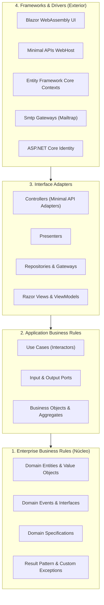
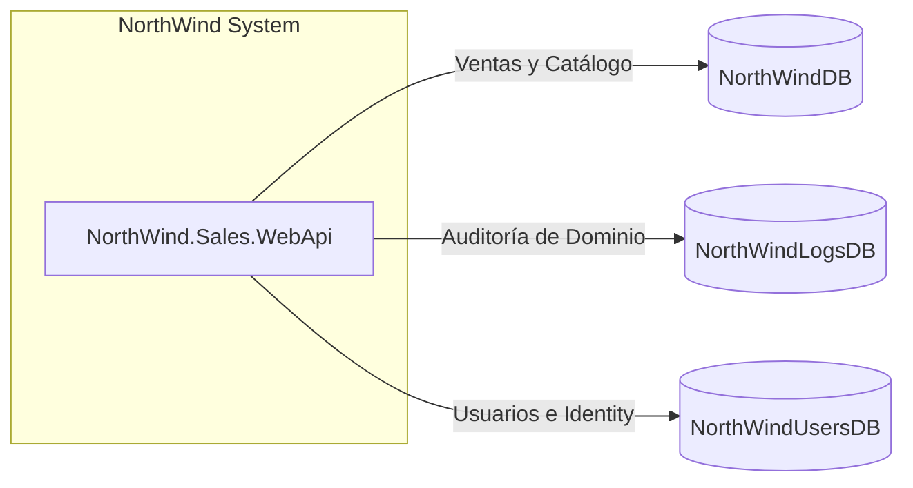

# NorthWind Sales System - Clean Architecture

[](https://dotnet.microsoft.com/)
[](https://learn.microsoft.com/dotnet/csharp/)
[](https://learn.microsoft.com/aspnet/core/fundamentals/minimal-apis)
[](https://dotnet.microsoft.com/apps/aspnet/web-apps/blazor)
[](https://learn.microsoft.com/ef/core/)
[](https://learn.microsoft.com/sql/database-engine/configure-windows/sql-server-express-localdb)
[](#2-arquitectura-de-software-y-patrones)

Sistema modular de gestión de ventas y órdenes desarrollado en **.NET 8** bajo los principios rigurosos de **Clean Architecture** (Arquitectura Limpia de Robert C. Martin). El proyecto combina un backend desacoplado basado en **Minimal APIs** y un frontend de una sola página (SPA) interactivo desarrollado en **Blazor WebAssembly**, incorporando múltiples bases de datos relacionales, eventos de dominio, transacciones distribuidas y seguridad basada en tokens JWT con ASP.NET Core Identity.

---

## Tabla de Contenidos

1. [Descripción del Proyecto](#1-descripción-del-proyecto)
2. [Arquitectura de Software y Patrones](#2-arquitectura-de-software-y-patrones)
3. [Bases de Datos del Sistema (LocalDB)](#3-bases-de-datos-del-sistema-localdb)
4. [Requisitos Previos](#4-requisitos-previos)
5. [Paso a Paso de Instalación y Migraciones de BD](#5-paso-a-paso-de-instalación-y-migraciones-de-bd)
6. [Configuración de appsettings.json](#6-configuración-de-appsettingsjson)
7. [Cómo Ejecutar la Aplicación](#7-cómo-ejecutar-la-aplicación)
8. [Guía de Uso y Prueba Funcional](#8-guía-de-uso-y-prueba-funcional)
9. [Mapa de Proyectos de la Solución](#9-mapa-de-proyectos-de-la-solución)

---

## 1. Descripción del Proyecto

**NorthWind Sales System** es una implementación de grado empresarial que modela el ciclo de vida de registro de órdenes de venta, validación de stock y créditos de clientes, auditoría centralizada y autenticación de usuarios. 

### Características Principales:
- **Estructura Concéntrica e Inversión de Dependencias:** Dependencias estrictamente orientadas hacia el núcleo de negocio, garantizando que el núcleo permanezca agnóstico respecto a la base de datos, frameworks UI y protocolos de transporte.
- **Backend Ligero y de Alto Rendimiento:** Implementado con **ASP.NET Core Minimal APIs**, reduciendo el overhead de controladores pesados y simplificando el enrutamiento.
- **Frontend SPA Moderno:** Interfaz de usuario rica construida con **Blazor WebAssembly (.NET 8)**, utilizando inyección de dependencias modular, manejo de estado de autenticación y delegación de handlers HTTP.
- **Transacciones Distribuidas:** Sincronización atómica entre diferentes bases de datos relacionales mediante `TransactionScope`.
- **Ecosistema de Notificaciones Desacoplado:** Envío asíncrono de correos electrónicos vía SMTP (Mailtrap) al activarse eventos de dominio para órdenes especiales.

---

## 2. Arquitectura de Software y Patrones

El sistema está organizado en **4 capas concéntricas** que respetan de manera estricta la **Regla de Dependencia** de Clean Architecture:



### Detalle de las 4 Capas:

1. **Enterprise Business Rules (Capa 1 - Núcleo):**
   - Contiene las entidades puras del dominio, tipos base, Value Objects, contratos de eventos y tipos de resultados. No tiene dependencias de librerías externas o frameworks de infraestructura.
2. **Application Business Rules (Capa 2):**
   - Contiene los casos de uso (Interactors) que orquestan el flujo de datos entre las entidades y puertos. Define los contratos de entrada (`InputPort`) y salida (`OutputPort`).
3. **Interface Adapters (Capa 3):**
   - Convierte los datos desde el formato más conveniente para los casos de uso hacia el formato requerido por la infraestructura externa (controladores HTTP, presentadores, repositorios y ViewModels).
4. **Frameworks & Drivers (Capa 4 - Capa Externa):**
   - Aloja las herramientas tecnológicas y librerías concretas: ASP.NET Core, Entity Framework Core, SQL Server, Blazor WebAssembly, Mailtrap y ASP.NET Core Identity.

### Patrones de Diseño Implementados:

- **`Result<T>` y `Result<TSuccess, TError>`:**
  - Evita el uso costoso de excepciones para el control de flujo. Modela de forma explícita operaciones que pueden resultar exitosas o fallidas, proporcionando métodos funcionales `HandleResult(...)` para ramificar la ejecución.
- **Specification Pattern (`Specification<T>`):**
  - Encapsula reglas de negocio complejas en objetos reutilizables y testeables mediante expresiones (`Expression<Func<T, bool>>`). Ejemplo: `SpecialOrderSpecification`, que evalúa si una orden contiene más de 3 productos (`order.OrderDetails.Count > 3`).
- **Domain Events (`IDomainEvent`, `IDomainEventHandler`, `IDomainEventHub`):**
  - Desacopla los efectos secundarios de los casos de uso. Cuando se cumple la especificación de orden especial, se dispara `SpecialOrderCreatedEvent`, el cual es capturado por un manejador SMTP para emitir una notificación por correo electrónico sin acoplar el caso de uso al envío de mails.
- **`TransactionScope` (Transacciones Distribuidas):**
  - Implementado en `DomainTransaction`, activa el soporte de transacciones implícitas distribuidas (`TransactionManager.ImplicitDistributedTransactions = true`) con nivel de aislamiento `ReadCommitted`. Permite confirmar o revertir de manera atómica cambios que impactan tanto a `NorthWindDB` (ventas) como a `NorthWindLogsDB` (auditoría).
- **FluentValidation + RFC 7807 (ProblemDetails):**
  - Validación declarativa de DTOs antes de alcanzar el dominio mediante `IModelValidatorHub`. Cuando ocurre una validación insatisfecha, el middleware captura `ValidationException` y serializa una respuesta estándar compatible con la especificación **RFC 7807 / RFC 7231 Problem Details**, detallando los campos inválidos.
- **ASP.NET Core Identity & JWT Authentication:**
  - Gestión integral de usuarios con hash seguro de contraseñas. El backend emite tokens firmados con clave simétrica (**HMAC-SHA256**), y el frontend gestiona el token en `localStorage` inyectándolo dinámicamente mediante delegating handlers (`MembershipBearerTokenHandler`) y adaptándolo al estado de Blazor con `JWTAuthenticationStateProvider`.

---

## 3. Bases de Datos del Sistema (LocalDB)

La solución utiliza una arquitectura de bases de datos desacoplada para garantizar separación de responsabilidades y modularidad:



| Base de Datos | Contexto EF Core | Propósito y Contenido |
| :--- | :--- | :--- |
| **`NorthWindDB`** | `NorthWindContext` / `NorthWindSalesContext` | Contiene el núcleo de ventas: tablas `Customers`, `Products`, `Orders` y `OrderDetails`. Incluye datos iniciales (*seed data*) de clientes (`ALFKI`, `ANATR`, `ANTON`) y productos con unidades en inventario (`Chai`, `Chang`, `Aniseed Syrup`, etc.). |
| **`NorthWindLogsDB`** | `NorthWindDomainLogsContext` | Registro de auditoría del sistema: almacena la tabla `Logs` (`Id`, `DateTime`, `User`, `Description`), capturando las órdenes creadas o canceladas y el usuario responsable. |
| **`NorthWindUsersDB`** | `NorthWindMembershipContext` | Gestión de seguridad e identidades: almacena el esquema estándar de ASP.NET Core Identity (`AspNetUsers`, `AspNetRoles`, `AspNetUserClaims`, etc.) para autenticación y autorización. |

---

## 4. Requisitos Previos

Antes de configurar y ejecutar el proyecto, asegúrate de contar con las siguientes herramientas en tu entorno:

1. **.NET 8 SDK** (versión 8.0.100 o superior).
   - Comprueba tu versión instalada:
     ```powershell
     dotnet --version
     ```
2. **SQL Server LocalDB** (incluido habitualmente con Visual Studio) o una instancia accesible de **SQL Server** / **SQL Server Express**.
   - Servidor por defecto: `(localdb)\mssqllocaldb`.
3. **Herramienta de Entity Framework Core CLI (`dotnet-ef`)**:
   - Para instalar o actualizar de forma global:
     ```powershell
     dotnet tool install --global dotnet-ef
     dotnet tool update --global dotnet-ef
     ```
4. **Entorno de Desarrollo (IDE)**:
   - **Visual Studio 2022** (v17.8+ con carga de trabajo *ASP.NET y desarrollo web*) o **Visual Studio Code** (con la extensión *C# Dev Kit*).
5. **Cuenta en Mailtrap (Opcional pero recomendada)**:
   - Para inspeccionar los correos de órdenes especiales enviados vía SMTP sin enviar correos reales.

---

## 5. Paso a Paso de Instalación y Migraciones de BD

### Paso 1: Clonar el Repositorio
```powershell
git clone <URL_DEL_REPOSITORIO>
cd NorthWind
```

### Paso 2: Iniciar SQL Server LocalDB
Abre una terminal de PowerShell o CMD y verifica el estado de la instancia local:

```powershell
# 1. Comprobar las instancias disponibles de LocalDB
sqllocaldb info

# 2. Iniciar la instancia predeterminada de LocalDB
sqllocaldb start mssqllocaldb

# 3. Verificar que la instancia esté en estado 'Running'
sqllocaldb info mssqllocaldb
```

> [!NOTE]
> Si la instancia `mssqllocaldb` no existe en tu equipo, puedes crearla ejecutando `sqllocaldb create mssqllocaldb` antes de iniciarla.

### Paso 3: Aplicar las Migraciones de Entity Framework Core
Ejecuta las siguientes migraciones en orden desde la **raíz de la solución** (`NorthWind`). Cada comando apunta a su respectivo proyecto de contexto y utiliza `NorthWind.Sales.WebApi` como proyecto de inicio para resolver la configuración de cadenas de conexión:

#### 1. Migración de Base de Datos de Ventas (`NorthWindDB`):
```powershell
dotnet ef database update --project NorthWind.Sales.Backend.DataContexts.EFCore --startup-project NorthWind.Sales.WebApi --context NorthWindContext
```
*Aplica las migraciones `InitialCreate` y `AddProductAndCustomer`, creando el esquema de ventas y poblando los datos iniciales de prueba.*

#### 2. Migración de Base de Datos de Auditoría (`NorthWindLogsDB`):
```powershell
dotnet ef database update --project NorthWind.DomainLogs.DataContexts.EFCore --startup-project NorthWind.Sales.WebApi --context NorthWindDomainLogsContext
```
*Aplica la migración `InitialCreate`, creando la tabla `Logs` para registrar las actividades de dominio.*

#### 3. Migración de Base de Datos de Membresía e Identity (`NorthWindUsersDB`):
```powershell
dotnet ef database update --project NorthWind.Membership.Backend.AspNetIdentity --startup-project NorthWind.Sales.WebApi --context NorthWindMembershipContext
```
*Aplica la migración `InitialMembershipCreate`, generando todas las tablas de ASP.NET Core Identity.*

---

## 6. Configuración de appsettings.json

El archivo de configuración principal se encuentra en:
📂 `NorthWind.Sales.WebApi/appsettings.json`

Verifica o actualiza sus secciones según tus credenciales de entorno:

```json
{
  "Logging": {
    "LogLevel": {
      "Default": "Information",
      "Microsoft.AspNetCore": "Warning"
    }
  },
  "AllowedHosts": "*",
  "ConnectionStrings": {
    "NorthWindDB": "Server=(localdb)\\mssqllocaldb;Database=NorthWindDB;Integrated Security=true;"
  },
  "DBOptions": {
    "ConnectionString": "Server=(localdb)\\mssqllocaldb;Database=NorthWindDB;Integrated Security=true;"
  },
  "DomainLogs": {
    "ConnectionString": "Server=(localdb)\\mssqllocaldb;Database=NorthWindLogsDB;Integrated Security=true;"
  },
  "MembershipDB": {
    "ConnectionString": "Server=(localdb)\\mssqllocaldb;Database=NorthWindUsersDB;Integrated Security=true;"
  },
  "Smtp": {
    "Host": "sandbox.smtp.mailtrap.io",
    "Port": 2525,
    "UserName": "TU_USUARIO_MAILTRAP",
    "Password": "TU_PASSWORD_MAILTRAP"
  },
  "JwtOptions": {
    "SecurityKey": "NorthWindSecretKeyForJwtTokenValidation2026!",
    "ValidIssuer": "NorthWindWebApi",
    "ValidAudience": "NorthWindClients",
    "ExpireInMinutes": 60,
    "ValidateIssuer": true,
    "ValidateAudience": true,
    "ValidateLifetime": true,
    "ValidateIssuerSigningKey": true
  }
}
```

> [!TIP]
> En el cliente Blazor WebAssembly (`NorthWind.Sales.BlazorClient/wwwroot/appsettings.json`), la propiedad `WebApiAddress` debe coincidir con la URL del backend (`https://localhost:7154`).

---

## 7. Cómo Ejecutar la Aplicación

Existen dos alternativas para ejecutar el sistema en paralelo:

### Opción 1: Desde Visual Studio 2022 (Recomendado)
La solución incluye el perfil `NorthWind.slnLaunch.user` preconfigurado:
1. Abre el archivo de solución `NorthWind.slnx` en Visual Studio 2022.
2. En el *Explorador de soluciones*, haz clic derecho sobre la solución y selecciona **Configurar proyectos de inicio...** (o selecciona el perfil de inicio múltiple en la barra superior).
3. Selecciona **Varios proyectos de inicio** y configura las siguientes acciones:
   - `NorthWind.Sales.WebApi` ➔ **Iniciar**
   - `NorthWind.Sales.BlazorClient` ➔ **Iniciar**
4. Presiona <kbd>F5</kbd> o <kbd>Ctrl</kbd> + <kbd>F5</kbd>. Visual Studio levantará ambos servicios y abrirá la aplicación en el navegador.

---

### Opción 2: Desde Terminal / Consola de Comandos
Abre **dos terminales independientes** en la raíz del repositorio:

#### Terminal 1: Iniciar el Backend (Minimal APIs)
```powershell
dotnet run --project NorthWind.Sales.WebApi/NorthWind.Sales.WebApi.csproj
```
- **Endpoints disponibles:**
  - Swagger UI: [https://localhost:7154/swagger](https://localhost:7154/swagger)
  - HTTP alternativo: `http://localhost:5254`

#### Terminal 2: Iniciar el Frontend (Blazor WebAssembly)
```powershell
dotnet run --project NorthWind.Sales.BlazorClient/NorthWind.Sales.BlazorClient.csproj
```
- **Interfaz Web Blazor:**
  - HTTPS: [https://localhost:7227](https://localhost:7227)
  - HTTP: `http://localhost:5289`

---

## 8. Guía de Uso y Prueba Funcional

Sigue este flujo paso a paso para verificar el comportamiento completo del sistema:

### Paso 1: Registro de Usuario
1. Ingresa a la interfaz web de Blazor en `https://localhost:7227`.
2. Navega a la ruta de registro: `/user/register` (o haz clic en el enlace de registro).
3. Ingresa los datos solicitados:
   - **Nombre completo**: `Administrador NorthWind`
   - **Correo electrónico**: `admin@northwind.com`
   - **Contraseña**: Debe cumplir con las reglas de Identity (ej. `Password123!`).
4. Confirma el formulario. El sistema persistirá el usuario en `NorthWindUsersDB`.

### Paso 2: Inicio de Sesión y Autenticación JWT
1. Dirígete a `/user/login`.
2. Ingresa el correo `admin@northwind.com` y la contraseña previamente registrados.
3. Al autenticar con éxito:
   - La API emite el token JWT firmado.
   - El cliente guarda el token en el `localStorage` del navegador mediante `TokenLocalStorage`.
   - `JWTAuthenticationStateProvider` notifica a los componentes Blazor, actualizando el menú superior con el estado autenticado del usuario.

### Paso 3: Creación de una Orden Estándar
1. Accede a la página protegida de creación de órdenes: `/CreateOrder` (requiere estar autenticado).
2. Completa los campos del formulario:
   - **Cliente**: Usa un código existente de la base de datos como `ALFKI` (Alfreds Futterkiste).
   - **Dirección de envío**: `Obere Str. 57`.
   - **Ciudad**: `Berlín`.
   - **Código Postal**: `12209`.
   - **País**: `Alemania`.
3. Agrega productos con inventario disponible:
   - **Producto ID 1** (`Chai`) — Cantidad: `2`, Precio: `35.00`.
   - **Producto ID 3** (`Aniseed Syrup`) — Cantidad: `1`, Precio: `65.00`.
4. Envía la orden:
   - El backend valida el modelo con FluentValidation.
   - Abre la transacción distribuida con `TransactionScope`.
   - Guarda la orden y detalles en `NorthWindDB`.
   - Registra en `NorthWindLogsDB` una entrada de auditoría con la plantilla `Orden {0} creada para el cliente {1}`.
   - Confirma la transacción y devuelve el ID generado de la orden.

> [!WARNING]
> Si intentas agregar el **Producto ID 2** (`Chang`), la orden será rechazada debido a que tiene `UnitsInStock = 0`. El sistema devolverá un error 400 serializado como **RFC 7807 ProblemDetails** indicando que el producto no cuenta con stock suficiente.

### Paso 4: Disparo de Orden Especial (> 3 Productos) y Verificación de Auditoría
1. En `/CreateOrder`, crea una orden que contenga **4 o más líneas de detalle de productos diferentes** con stock:
   - Producto 1 (`Chai`)
   - Producto 3 (`Aniseed Syrup`)
   - Producto 4 (`Chef Anton's Cajun Seasoning`)
   - Producto 5 (`Chef Anton's Gumbo Mix`)
2. Al procesarse:
   - La regla `SpecialOrderSpecification` evalúa `order.OrderDetails.Count > 3` como **verdadero**.
   - Se eleva el evento de dominio `SpecialOrderCreatedEvent`.
   - El manejador `SpecialOrderCreatedEventHandler` envía un correo asíncrono a `admin@northwind.com` mediante Mailtrap.
   - Puedes abrir tu bandeja de entrada en [Mailtrap](https://mailtrap.io/) para visualizar el correo con el asunto y número de productos.
3. Revisa la base de datos `NorthWindLogsDB` en SQL Server Management Studio o Azure Data Studio:
   ```sql
   SELECT * FROM NorthWindLogsDB.dbo.Logs ORDER BY DateTime DESC;
   ```
   Observarás el registro exacto del usuario autenticado, fecha, hora y descripción de la orden creada.

---

## 9. Mapa de Proyectos de la Solución

La solución `NorthWind.slnx` se compone de **30 proyectos modulares**, distribuidos estrictamente según su responsabilidad arquitectónica:

### 1. Enterprise Business Rules
| Proyecto | Descripción |
| :--- | :--- |
| `NorthWind.Entities` | Contratos base, tipos compartidos y entidades primitivas de dominio. |
| `NorthWind.Sales.Entities` | DTOs de venta (`CreateOrderDto`, `OrderDetailDto`), entidades y rutas de endpoints de ventas. |
| `NorthWind.DomainLogs.Entities` | Entidad de auditoría de dominio `DomainLog` (`Id`, `DateTime`, `User`, `Description`). |
| `NorthWind.Membership.Entities` | DTOs para membresía (`UserRegistrationDto`, `UserLoginDto`, `UserDto`) y rutas de usuario. |
| `NorthWind.Events.Entities` | Abstracciones base para el bus de eventos de dominio (`IDomainEvent`, `IDomainEventHub`). |
| `NorthWind.Exceptions.Entities` | Excepciones del dominio (`ValidationException`, `UpdateException`) y formato RFC 7807 `ProblemDetails`. |
| `NorthWind.Result.Entities` | Implementación del patrón de tipos de resultado funcional `Result<T>` y `Result<TSuccess, TError>`. |
| `NorthWind.Transactions.Entities` | Abstracción del patrón de transacciones distribuidas `IDomainTransaction` e implementación con `TransactionScope`. |
| `NorthWind.Validation.Entities` | Contratos genéricos para validación de modelos (`IModelValidator`, `IModelValidatorHub`). |
| `NorthWind.Sales.Validators.Entities` | Reglas de validación y modelos para entidades de ventas. |
| `NorthWind.HttpDelegatingHandlers` | Delegating Handlers para gestión de excepciones HTTP en clientes. |

### 2. Application Business Rules
| Proyecto | Descripción |
| :--- | :--- |
| `NorthWind.Sales.Backend.UseCases` | Casos de uso de ventas (`CreateOrderInteractor`), validaciones con guardas y orquestación de transacciones. |
| `NorthWind.Sales.Backend.BusinessObjects` | Agregados de negocio (`OrderAggregate`), POCOs, eventos (`SpecialOrderCreatedEvent`) y `SpecialOrderSpecification`. |
| `NorthWind.Sales.Frontend.BusinessObjects` | Modelos de negocio e interfaces orientadas a la capa cliente de ventas. |
| `NorthWind.Membership.Backend.Core` | Casos de uso de autenticación (`UserLoginInteractor`, `UserRegistrationInteractor`) y generación de tokens JWT. |

### 3. Interface Adapters
| Proyecto | Descripción |
| :--- | :--- |
| `NorthWind.Sales.Backend.Controllers` | Endpoints de ventas para Minimal APIs (`CreateOrderController`). |
| `NorthWind.Sales.Backend.Presenters` | Presentadores que transforman las respuestas del caso de uso para los controladores (`CreateOrderPresenter`). |
| `NorthWind.Sales.Backend.Repositories` | Repositorios de persistencia (`CommandsRepository`) e interfaces de consultas y comandos. |
| `NorthWind.Sales.Frontend.Views` | Páginas y componentes Blazor de ventas (`CreateOrder.razor`, `CreateOrderComponent.razor`). |
| `NorthWind.Sales.Frontend.WebApiGateways` | Gateway cliente que consume la Minimal API de ventas vía HTTP. |
| `NorthWind.Membership.Frontend.RazorViews` | Vistas Razor de login y registro (`UserLoginPage.razor`, `UserRegistrationPage.razor`, `TokenLocalStorage`). |
| `NorthWind.RazorComponents` | Componentes visuales transversales (`ExceptionDisplay.razor`, menús y layouts). |

### 4. Frameworks And Drivers
| Proyecto | Descripción |
| :--- | :--- |
| `NorthWind.Sales.WebApi` | Proyecto principal de inicio del Backend (ASP.NET Core Minimal API, Swagger, CORS, JWT Auth). |
| `NorthWind.Sales.BlazorClient` | Aplicación de inicio Frontend SPA en Blazor WebAssembly (.NET 8). |
| `NorthWind.Sales.Backend.DataContexts.EFCore` | DbContext de ventas (`NorthWindContext`, `NorthWindSalesContext`), configuraciones Fluent API y migraciones EF Core. |
| `NorthWind.DomainLogs.DataContexts.EFCore` | DbContext de auditoría (`NorthWindDomainLogsContext`) y migraciones hacia `NorthWindLogsDB`. |
| `NorthWind.Membership.Backend.AspNetIdentity` | Integración con ASP.NET Core Identity (`NorthWindMembershipContext`), gestión de usuarios y migraciones hacia `NorthWindUsersDB`. |
| `NorthWind.Sales.Backend.SmtpGateways` | Manejador de eventos SMTP (`SpecialOrderCreatedEventHandler`) con conexión hacia Mailtrap. |
| `NorthWind.ValidationService.FluentValidation` | Implementación del motor de validación basado en la librería FluentValidation. |
| `NorthWind.UserServices` | Servicio de resolución del usuario autenticado en la sesión (`IUserService`). |
| `NorthWind.Sales.Backend.IoC` | Contenedor de Inversión de Control para registrar las dependencias backend de ventas en `IServiceCollection`. |
| `NorthWind.Sales.Frontend.IoC` | Contenedor de Inversión de Control para dependencias del cliente WebAssembly. |

---

## Licencia

Este proyecto está disponible bajo fines formativos y profesionales demostrando buenas prácticas de ingeniería de software con .NET 8 y Clean Architecture.
